## TP4DPBO2526C2

## Janji

Saya Rhafa Farell Valeno dengan NIM 2508020 mengerjakan Tugas Praktikum 5 dalam mata kuliah Desain Pemrograman Berorientasi Objek. Saya tidak melakukan kecurangan yang telah dispesifikasikan. Aamiin.

## Deskripsi
Aplikasi GUI berbasis Java Swing yang terintegrasi dengan database MySQL/MariaDB menggunakan JDBC Driver. Aplikasi ini digunakan untuk mengelola data *Person* dengan fitur CRUD (Create, Read, Update, Delete) serta dilengkapi dengan validasi *error prompt*.

## Fitur Utama
1. **Read (Tampil Data):** Menampilkan seluruh data `person` dari database ke dalam tabel GUI.
2. **Create (Tambah Data):** Menambahkan data baru ke database dengan validasi kolom kosong dan pencegahan ID duplikat.
3. **Update (Ubah Data):** Mengubah data yang dipilih dari tabel ke database.
4. **Delete (Hapus Data):** Menghapus data dari database dengan dialog konfirmasi (*JOptionPane*).
5. **Clear Form:** Mengosongkan form input dan mengembalikan status tombol ke keadaan awal.

## Struktur Database
- **Database Name:** `db_people`
- **Table Name:** `person`
  - **Atribut Table:**
    - `id` (VARCHAR 50, PRIMARY KEY)
    - `nama` (VARCHAR 100)
    - `thn_lahir` (INT)
    - `kategori` (VARCHAR 50)
    - `email` (VARCHAR 100)

## Panduan Menjalankan Program
1. Pastikan MariaDB atau MySQL lokal sudah aktif.
2. Buat database `db_people` dan tabel `person` sesuai skema.
3. Buka proyek di IntelliJ IDEA dan pastikan `lib/mysql-connector-j-26.7.0.jar` telah terdaftar pada *Project Structure -> Modules -> Dependencies*.
4. Jalankan `PeopleMenu.java`.

## Dokumentasi Pengujian Aplikasi

### 1. Tampilan Awal & Konfigurasi Proyek
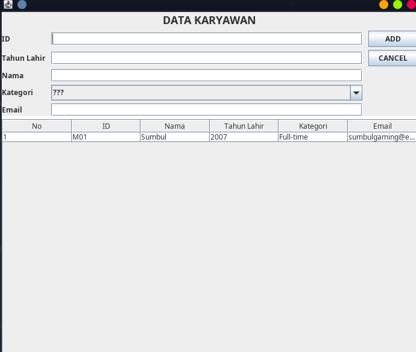
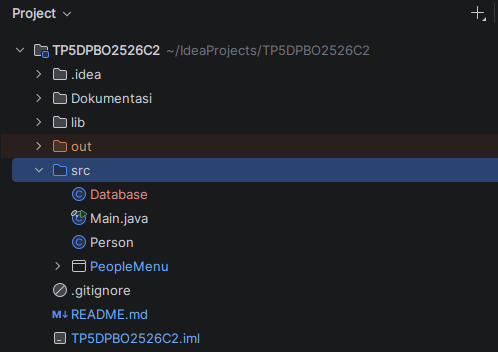
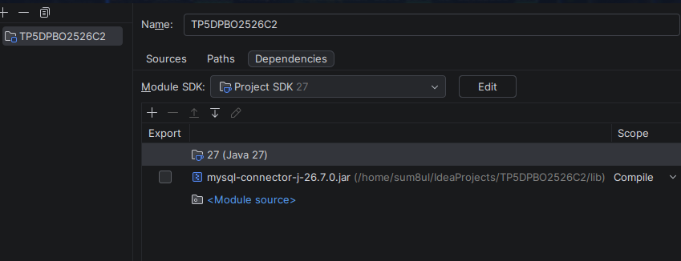
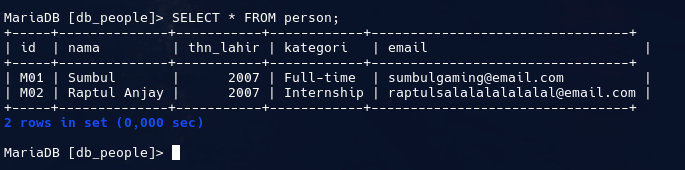

---

### 2. Validasi Error Prompt Input
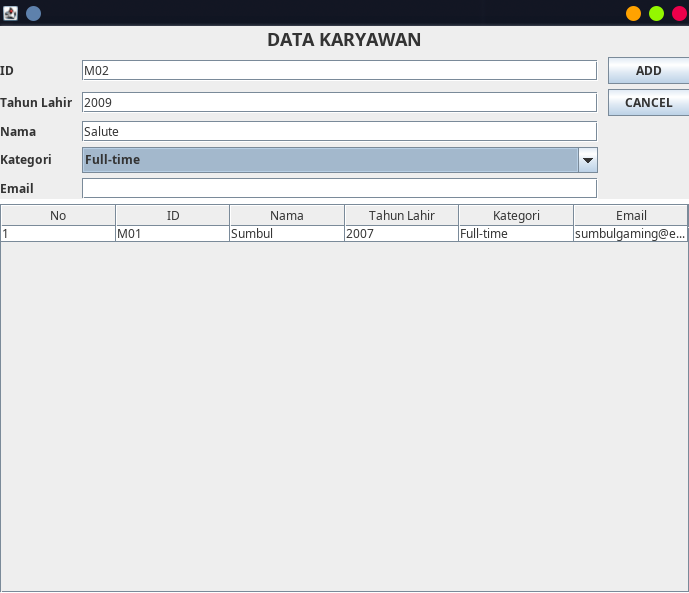
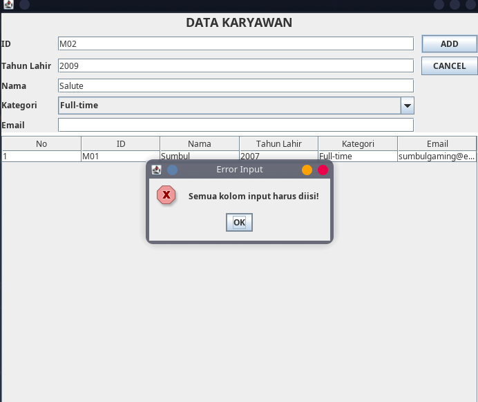
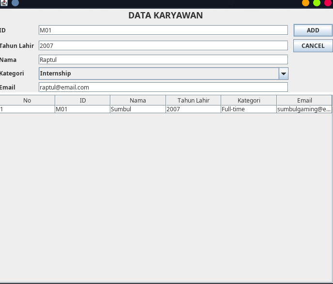
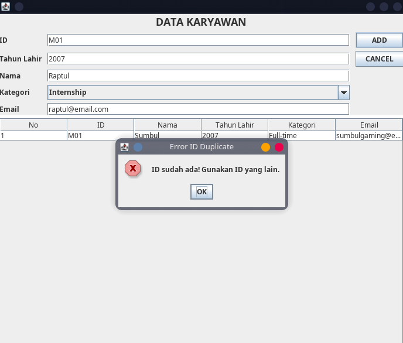

---

### 3. Tambah Data (Create)
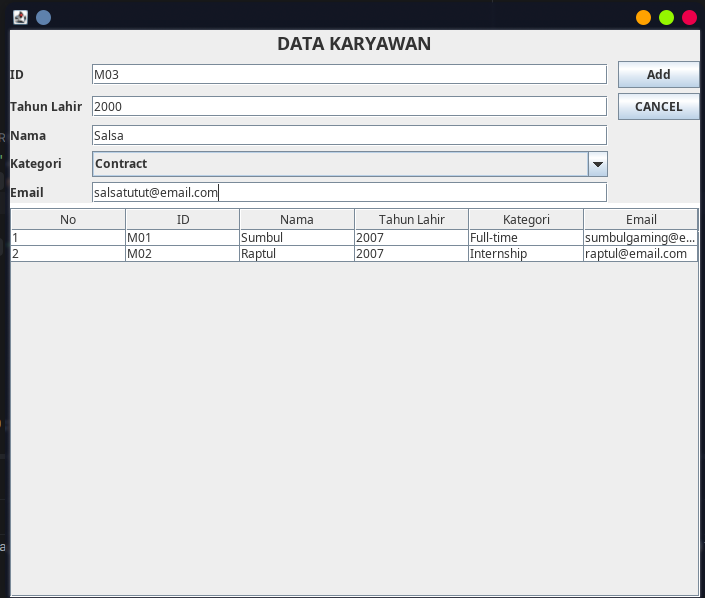
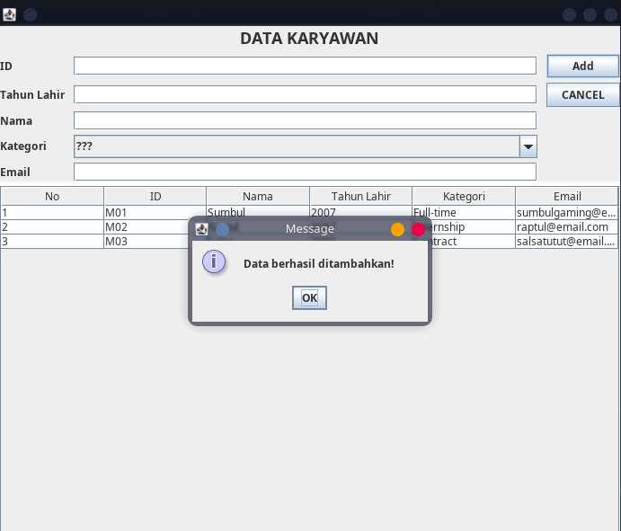

---

### 4. Ubah Data (Update)
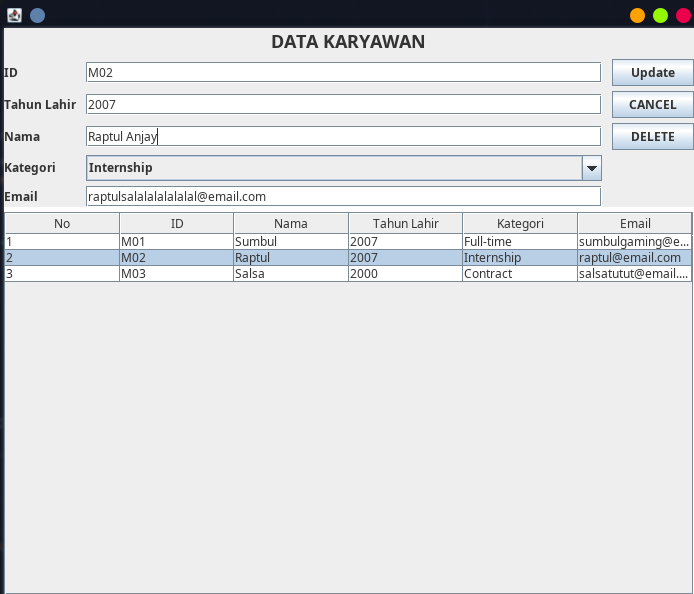
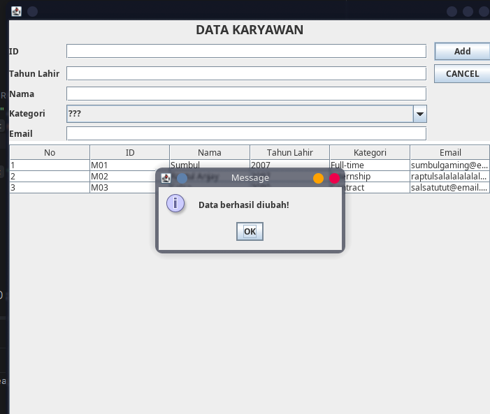

---

### 5. Hapus Data (Delete)
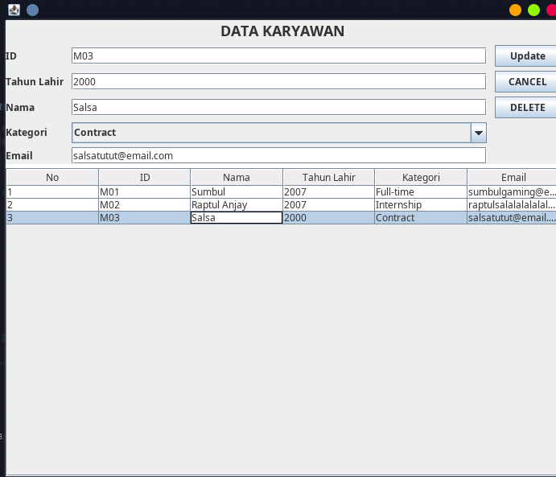
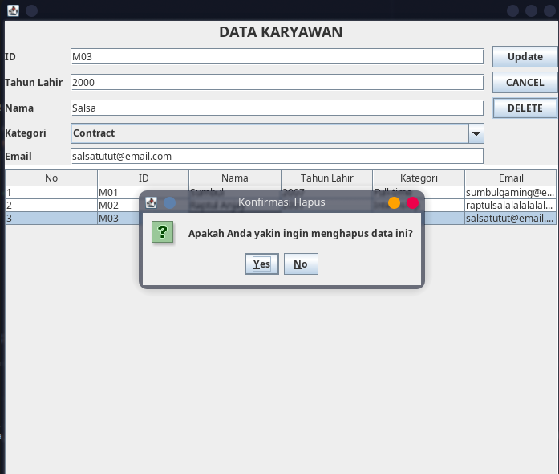
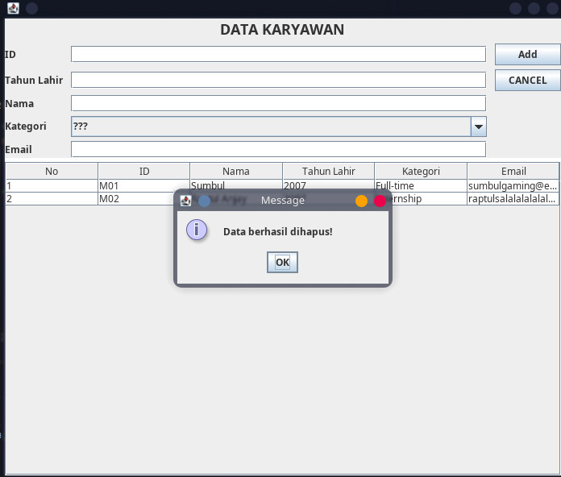
