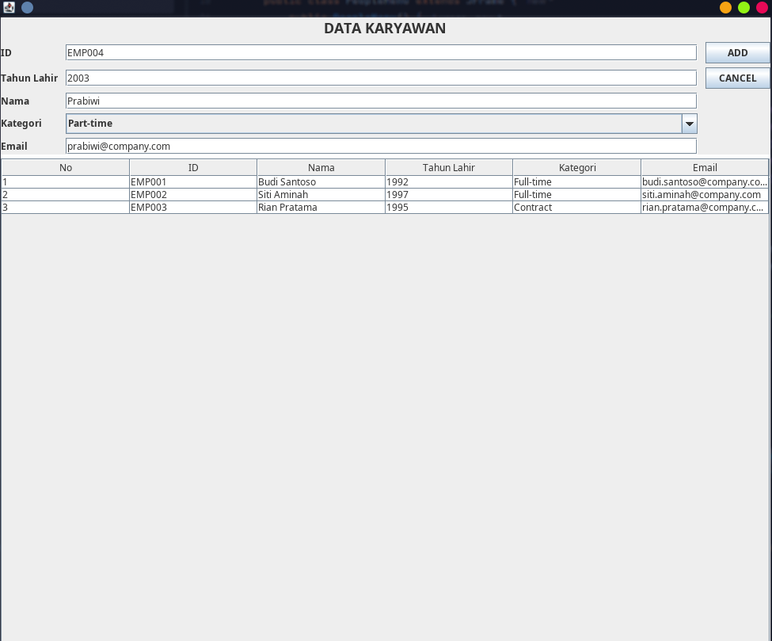
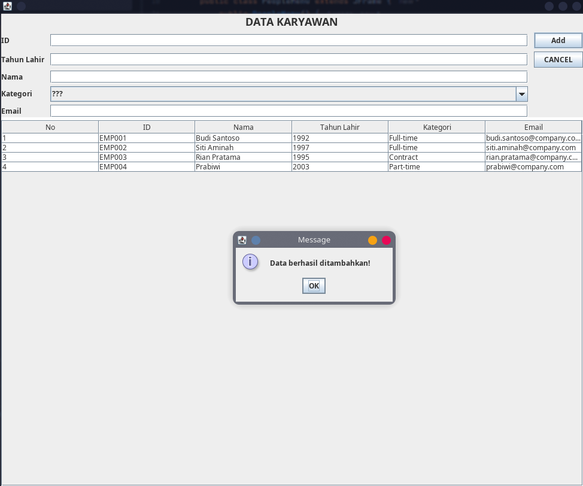
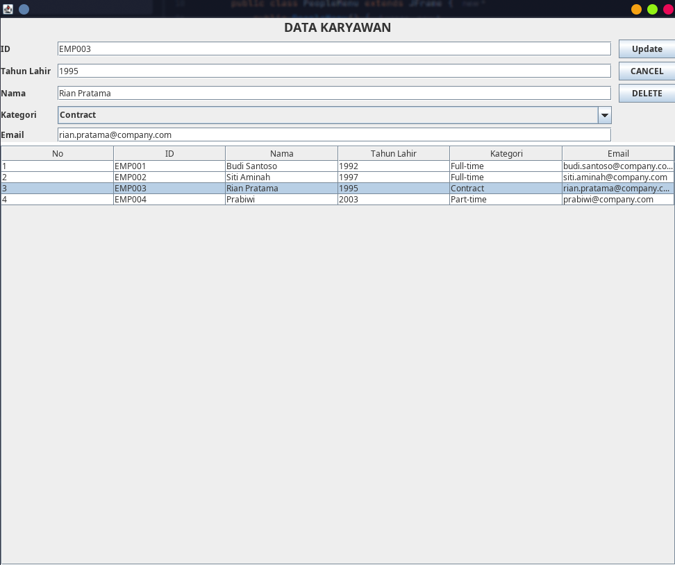
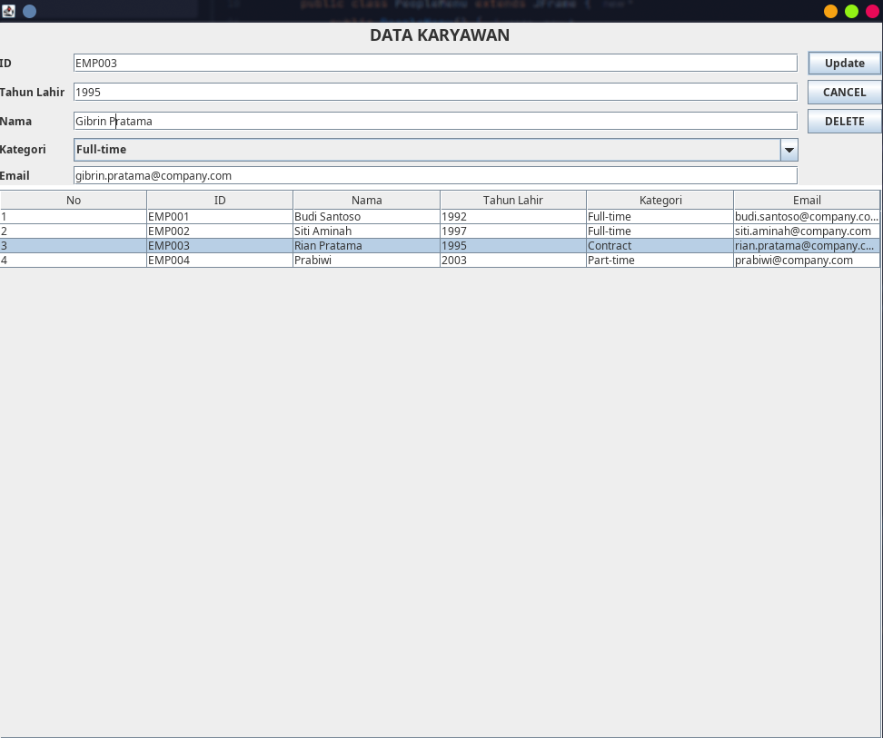
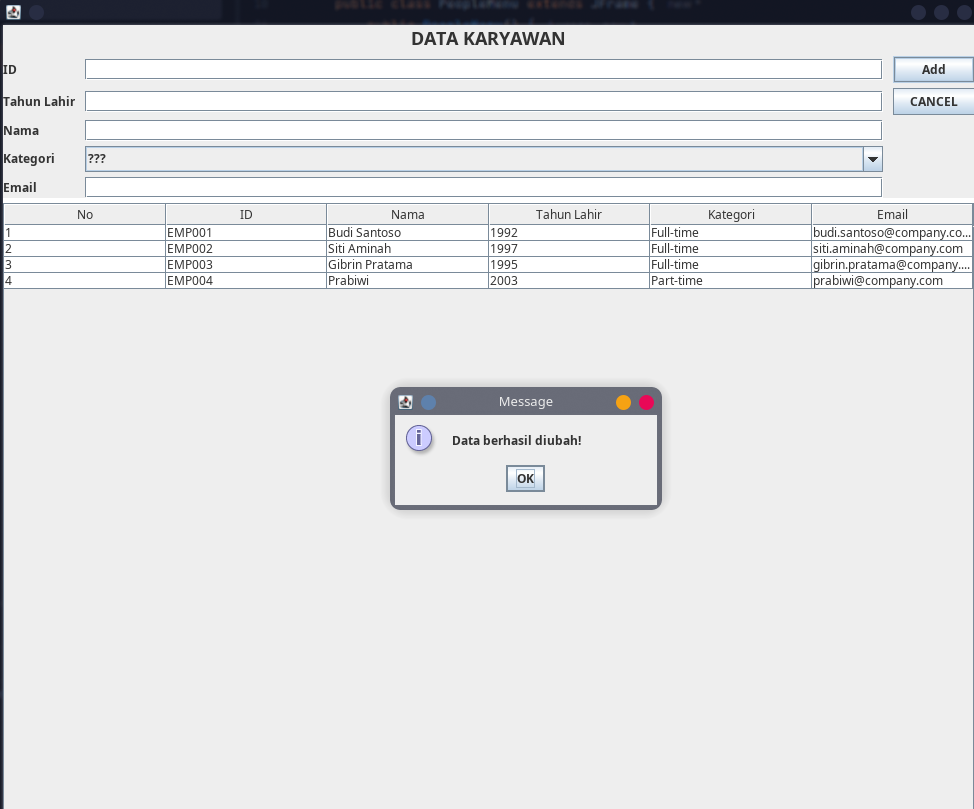
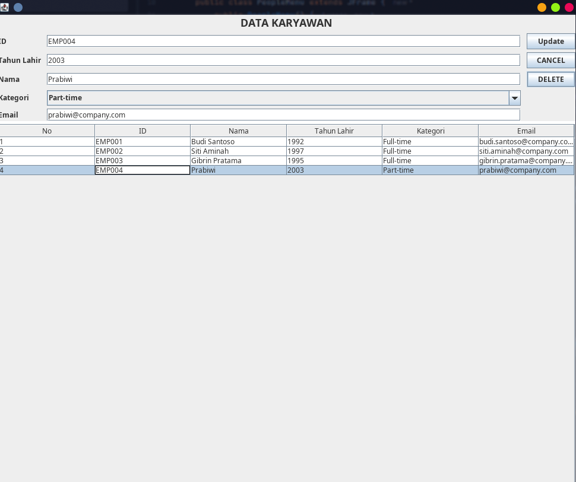
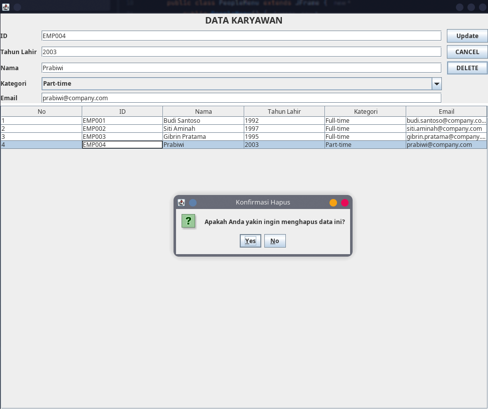
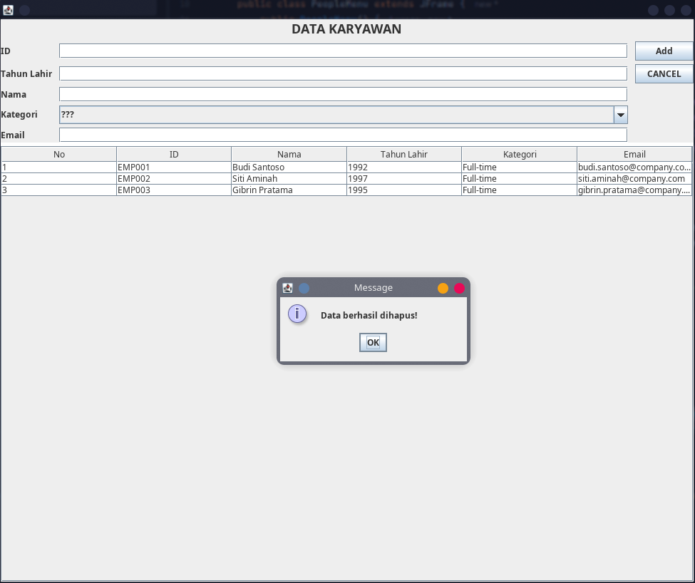

## TP4DPBO2526C2

## Janji

Saya Rhafa Farell Valeno dengan NIM 2508020 mengerjakan Tugas Praktikum 4 dalam mata kuliah Desain Pemrograman Berorientasi Objek. Saya tidak melakukan kecurangan yang telah dispesifikasikan. Aamiin.

Aplikasi GUI berbasis Java Swing untuk mengelola data *People/Karyawan* dengan mengimplementasikan operasi **CRUD** (Create, Read, Update, Delete) serta dialog konfirmasi hapus data.

## 📌 Desain & Fungsi Program
- **Model (`Person.java`)**: Memuat atribut `ID`, `Nama`, `Tahun Lahir`, `Kategori`, serta atribut tambahan `Email`.
- **Interface (`PeopleMenu.form`)**: Menggunakan komponen Swing seperti `JTextField`, `JComboBox`, `JButton`, dan `JTable` di dalam `JScrollPane`.
- **Logika (`PeopleMenu.java`)**:
    - Menyimpan data di dalam `ArrayList<Person>`.
    - Menampilkan data pada `JTable`.
    - Mengubah mode tombol `Add` menjadi `Update` secara otomatis saat baris tabel diklik.
    - Menampilkan `JOptionPane` konfirmasi sebelum menghapus data.

---

## Alur Kerja 
1. **Create (Tambah Data)**: Isi seluruh bidang input (ID, Nama, Tahun Lahir, Kategori, Email) lalu klik tombol **Add**.
2. **Read (Tampilkan Data)**: Data awal diisi otomatis via `populateList()` dan ditampilkan di tabel.
3. **Update (Ubah Data)**: Klik salah satu baris data pada tabel. Data akan terisi ke form, lalu tombol **Add** berubah menjadi **Update** dan tombol **Delete** muncul. Ubah data lalu klik **Update**.
4. **Delete (Hapus Data)**: Klik baris data pada tabel, lalu klik tombol **Delete**. Akan muncul pop-up konfirmasi *"Apakah Anda yakin ingin menghapus data ini?"*. Jika diklik **Yes**, data akan terhapus.
5. **Cancel**: Membersihkan form input dan mengembalikan mode ke tombol **Add**.

---

## 📷 Dokumentasi Program

### 1. Tambah Data (Create)

### 2. Ubah Data (Update)

### 3. Hapus Data (Delete)

